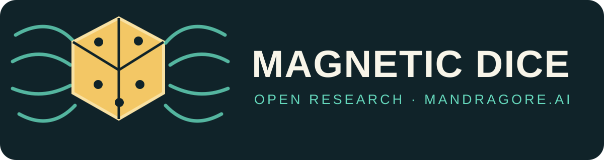
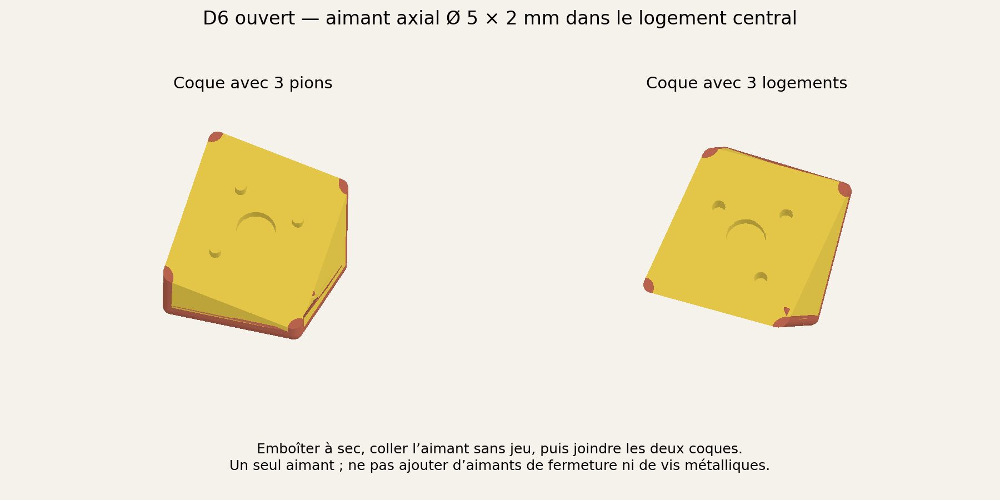

# Reconnaissance de dés passifs par champ magnétique — état de recherche

**[Mandragore.ai](https://mandragore.ai/) · [Maitresinh@500nuancesdegeek.fr](mailto:Maitresinh@500nuancesdegeek.fr)**

**Licence commerciale :** les fichiers publiés jusqu'au 6 novembre 2026
restent sous leurs licences MIT ou CC BY 4.0, y compris pour les personnes
qui les ont déjà reçus. Les nouvelles contributions originales publiées à
partir du 7 novembre sont destinées à l'usage non commercial, sauf licence
particulière indiquée avec le fichier. Lire [la notice de transition](LICENSING-2026-11-07.md)
avant toute réutilisation commerciale ; nous contacter pour un accord.

Vous poursuivez ce travail ? Nous serions heureux de recueillir vos données expérimentales et vos améliorations : dé et aimant utilisés, géométrie, capteurs, protocole, mesures brutes, réussites, erreurs et refus. Écrivez-nous ou ouvrez une issue / pull request. Retirez les données personnelles et précisez les conditions de partage.

**Mandragore.ai · 6 novembre 2026 · prototype de recherche**

Objectif : obtenir la donnée de lecture de dés physiques après un lancer.

L'utilisation d'un aimant à plusieurs avantages : 

- pas de batterie dans le dé, aucune  electronique
- Pas de contact de la main au moment du résultat (contrairement aux marqueurs capacitifs tenus en main)
- Très bon marché et facile à monter (deux coques).

Le prototype est un D6 imprimé en 3D (PLA, option PLA+ arretes TPU) avec un aimant fixe. Le magnétomètre d'un Nexus 5 mesure le champ quand le dé est immobilisé. Il utilise un entrainement (machine learning basique).
Les fichiers de fabrication et le banc d’essai sont fournis ci-dessous.

Intérêt : transmettre les résultats du dés permet à des applications de connaitre les jets sans les reporter manuellement.

## Fichiers du prototype D6

- **Modèle imprimable :** [projet Bambu Studio 3MF](D6_aimant_deux_coques.3mf), limité au D6 magnétique.
- **STL coque 1 :** [PLA](D6_coque_1_PLA_2.stl) et [TPU](D6_coque_1_TPU_AMS_1.stl).
- **STL coque 2 :** [PLA](D6_coque_2_PLA_2.stl) et [TPU](D6_coque_2_TPU_AMS_1.stl).
- **Banc d’essai magnétique :** [APK Android](magnetic-d6-bench-debug.apk) et [sources](magnetic-d6-bench-source.zip). Il lit le magnétomètre, apprend les six faces, teste à l’aveugle et exporte uniquement des mesures `dice_mag_*`. Aucun code capacitif n’y est inclus.

Le 3MF conserve les matières et l’assemblage. Les quatre STL sont les volumes alignés des deux coques : importer les volumes d’une même coque ensemble, sans recentrage séparé, puis attribuer PLA et TPU. Immobiliser **un seul aimant néodyme axial Ø 5 × 2 mm** dans le logement avant de fermer les coques. Cette image est un dessin de montage, pas une photo du dé testé.

### Construire et utiliser le banc

Décompresser l’archive source. Prérequis : JDK 8, Android SDK 28, Gradle 4.10.1 et plugin Android 3.3.2 ; lancer `gradle assembleDebug`. L’APK autonome a compilé le 6 novembre 2026 mais n’a pas encore eu d’essai physique distinct. Immobiliser le téléphone et son câble, mesurer la référence sans aimant, puis apprendre au moins 12 orientations de chaque face en indiquant **le chiffre visible sur le dessus**. Retirer la main avant chaque mesure. Figer le modèle avant de tester de nouvelles poses et renseigner la vraie face après la prédiction. Ce banc suppose **un seul D6 et une zone fixe**.

## Ce qui a été mesuré

Le D6 de référence est un cube de **20 mm de côté**, doté d'un aimant axial **5 × 2 mm**. Sa plus grande dimension entre sommets vaut environ **34,6 mm**. L'application apprend la signature magnétique de chaque face à différentes orientations, puis peut annoncer une face ou refuser si la mesure est ambiguë.

L'audit de la campagne du 30 octobre 2026 retient **102 poses stabilisées** pour l'apprentissage : 13 pour chacune des faces 1, 2, 3, 5 et 6, et 37 pour la face 4. Une pose, et non chaque trame du capteur pendant cette pose, constitue une observation. Le modèle de l'application a été figé avant **10 nouvelles poses étiquetées** : **8 faces correctes, 2 refus, 0 face erronée annoncée**. Parmi elles, 8 poses guidées ont donné 7 réponses correctes et 1 refus ; 2 poses libres ont donné 1 réponse correcte et 1 refus.

Ce résultat démontre une lecture possible dans ce petit essai sur un téléphone et un dé donnés. Il ne mesure pas la fiabilité en usage courant, la lecture simultanée de plusieurs dés, ni la transférabilité à d'autres téléphones. Les faces déclarées, les rotations et l'immobilité du téléphone n'ont pas toutes été vérifiées par une mesure indépendante. La face 4 est beaucoup plus représentée que les autres.

Deux variantes logicielles ont été étudiées après la collecte : une courbe harmonique par face et une courbe robuste. Leur diagnostic en retirant une pose d'apprentissage donne respectivement **86 bonnes réponses / 16 refus / 0 erreur** et **92 / 10 / 0**. Sur les 10 poses nouvelles rejouées après coup, elles donnent **6 / 4 / 0** et **7 / 3 / 0**, contre **8 / 2 / 0** pour l'application initiale. Ces essais ne prouvent donc aucun gain du nouveau modèle. Une nouvelle série prospective, avec algorithme et seuils figés au préalable, est nécessaire.

## Ce qui n'est encore qu'une simulation

Des modèles géométriques ont exploré D8, D10, D12 et D20, des dés de différentes tailles et des dispositions d'un, deux ou trois aimants. La séparation minimale simulée entre projections verticales normalisées des faces vaut **0,337 pour le D6, 0,251 pour le D8, 0,159 pour le D10, 0,131 pour le D12 et 0,0617 pour le D20**. L'axe optimal simulé du D6 peut différer de celui de notre prototype ; ces nombres ne sont pas des taux de reconnaissance. Le D10 simulé représente une géométrie particulière.

Le D12 et surtout le D20 imposent de contrôler plus finement la position, l'orientation de l'aimant, les variations de fabrication et le bruit. Un aimant plus puissant ou un second aimant peut accroître le signal, mais aussi saturer un capteur proche, modifier la signature, attirer d'autres dés et déplacer le centre de masse. Ces choix restent à comparer expérimentalement. Le modèle actuel est ancré sur les amplitudes du D6, mais ne reproduit pas assez fidèlement ses six courbes réelles pour prédire un taux de réussite crédible pour les autres dés.

Une surface d'environ **30 × 30 cm** équipée de plusieurs magnétomètres trois axes est également étudiée pour reconstruire simultanément la position et la face de **3 à 5 dés**. Des simulations comparent des grilles de 16, 25 et 64 capteurs. Elles supposent notamment des dés stabilisés, des aimants immobilisés et une géométrie connue. Aucune de ces grilles n'a encore été construite ni validée pour plusieurs lancers réels. Une petite tuile de 9 à 16 capteurs serait la première étape matérielle.

## Questions ouvertes et TODO

- [ ] **D8 et D10 :** concevoir les logements d'aimant, fabriquer les deux dés, apprendre chaque face et évaluer sur des poses et lancers nouveaux. Décrire explicitement la géométrie du D10 retenu.
- [ ] **Dés plus petits, notamment D12 et D20 :** comparer une meilleure implantation magnétique, un aimant plus fort et deux aimants, sans supposer que davantage de matière magnétique améliore automatiquement l'identification. Mesurer la gamme du capteur, le bruit et les erreurs après repositionnement.
- [ ] **Identifier plusieurs dés simultanément :** comparer des signatures individualisées par dé (par exemple de petits décalages contrôlés de l'aimant ou des configurations distinctes) et une identification séparée, puis mesurer les risques de confusion et d'échange entre dés. Une simple liste d'identifiants RFID, si elle est ajoutée, ne relie pas à elle seule chaque dé à sa position après le lancer.
- [ ] **Équilibrage :** concevoir les logements, la colle et les contrepoids pour rapprocher le centre de masse du centre géométrique ; mesurer les masses et vérifier ensuite la distribution des résultats sur des lancers répétés. Un centre de masse correct ne suffit pas à prouver l'équité.
- [ ] **Surface de détection :** construire une petite tuile magnétique, puis étudier son extension à une zone de lancer dédiée qui remplace la tablette et localise plusieurs dés. Comparer une surface magnétique seule à une éventuelle fusion avec des positions capacitives effectivement mesurées.
- [ ] **Protocole de validation :** séparer apprentissage, réglage des seuils et test final ; conserver les refus ; rapporter les erreurs de face, de nombre de dés, d'association et de position par lancer complet. Tester bords, dés voisins, types mélangés et déplacement du fond magnétique.

## Licence et citation

Le texte, le logo, le dessin de montage, le 3MF et les STL sont sous [CC BY 4.0](LICENSE-HARDWARE.md). Le [code du banc](LICENSE-CODE.txt) est sous MIT. Dans les deux cas, citer **Mandragore.ai / 500 Nuances de Geek, « Magnetic Dice — reconnaissance de dés passifs », 2026**, avec [lien vers ce dépôt](https://github.com/Mandragore-ai/magnetic-dice-research) et indication des modifications. Voir [CITATION.cff](CITATION.cff). Les données et scripts de recherche non inclus ne sont pas couverts par cette publication.
